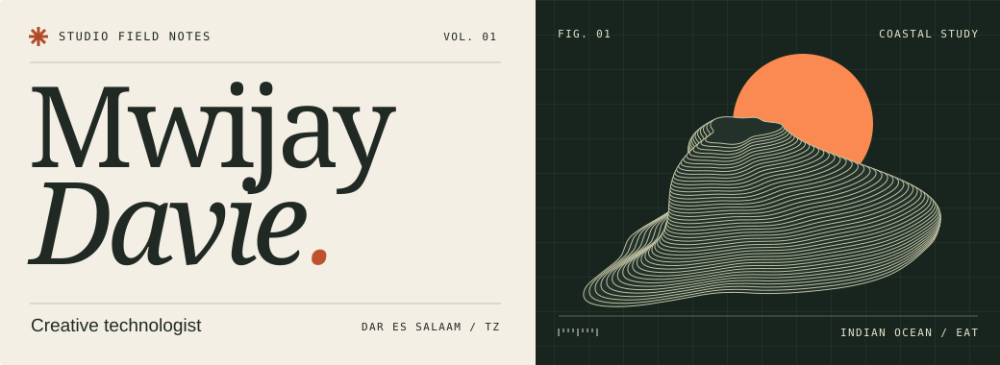
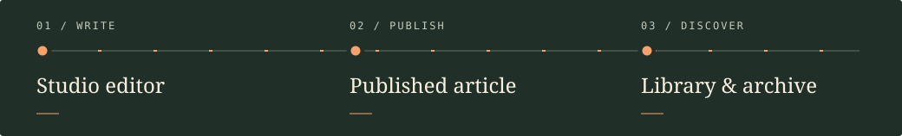

# Mwijay Davie · Studio portfolio



**[Visit the portfolio](https://mwijayportfolio.vercel.app/)** · [Work index](https://mwijayportfolio.vercel.app/projects) · [Studio library](https://mwijayportfolio.vercel.app/library) · [Client portal](https://mwijayportfolio.vercel.app/client-portal)

I build software for the work people do every day in Tanzania: recording a shop sale, preparing a care report, checking a student’s attendance. **[Altraware](https://altra.tanzaniareach.com/)** is my primary venture. Through **[Mwijay Studio](https://mwijay-studio.vercel.app/)**, I also design websites, storefronts and automations. This repository brings the public portfolio and the studio’s client workspace together.

## Selected work

| Project | What it does | Catalogue status |
| :--- | :--- | :--- |
| [Faida POS](https://faida-hq.vercel.app/) | Sales, stock, receipts and M-Pesa records for retailers | Live |
| [CareTrack](https://caretrack-six.vercel.app/dashboard) | Care centre records and reporting | Live demo · fictional data |
| [ShuleDirect](https://altra.tanzaniareach.com/work#shuledirect) | Fees, attendance and term reports for schools | In development |

These are editorial statuses, not uptime checks. The [work catalogue](src/lib/portfolio.ts) records the review date and includes projects from both ventures.

## Inside the studio

- **Explore** — [About](https://mwijayportfolio.vercel.app/about) introduces the person behind the work; the [gallery](https://mwijayportfolio.vercel.app/projects/gallery) takes you beyond the selected index.
- **Read or buy** — the [library](https://mwijayportfolio.vercel.app/library) pairs published articles with practical client guides. The [market](https://mwijayportfolio.vercel.app/market) lists available digital editions; [pricing](https://mwijayportfolio.vercel.app/pricing) is for services.
- **Start a project** — send a [brief](https://mwijayportfolio.vercel.app/book), then use the [client portal](https://mwijayportfolio.vercel.app/client-portal) for milestones, messages, files, payments and orders.



Editors manage articles at `/admin/blogs`. A draft stays out of the public feed; publishing makes it eligible for the latest-three shelf and the [full archive](https://mwijayportfolio.vercel.app/blog). Product availability works similarly. See [publishing and rollout notes](docs/portfolio-updates.md#publishing-and-discovery) before changing Firestore rules or indexes.

## Run locally

The site uses **Next.js 15 App Router**, **React 19** and **TypeScript**, with Tailwind CSS and GSAP for the interface. Firebase Auth and Firestore power the signed-in workspaces and live content.

```sh
git clone https://github.com/mwijaydavie/mwijayportfolio.git
cd mwijayportfolio
npm ci --legacy-peer-deps
npm run dev
```

Open **http://localhost:9005**. You can explore the editorial portfolio without Firebase. To test publishing, sign-in or orders, configure a **development** Firebase project in `.env.local` using the `NEXT_PUBLIC_FIREBASE_*` names in [the client initializer](src/lib/firebase.ts). Admin pages also require an authorized account. Keep private keys and service credentials out of the repository.

```sh
npm run typecheck   # TypeScript checks
npm run build       # Create the production build
npm start           # Serve that build (default port 3000)
```

## Find your way around the source

| If you want to change… | Start here |
| :--- | :--- |
| Featured work, About or the editorial homepage | [Project data](src/lib/portfolio.ts) · [Portfolio components](src/components/portfolio/) |
| The library, market or publication filters | [Resource shelves](src/components/resources/) · [Public queries](src/lib/public-catalog.ts) |
| Client workflows or studio controls | [Client portal](src/app/client-portal/) · [Admin routes](src/app/admin/) |
| Database access or query indexes | [Firestore rules](firestore.rules) · [Indexes](firestore.indexes.json) |
| The illustrations in this README | [SVG plates](docs/readme/) · self-contained, with reduced-motion support |
